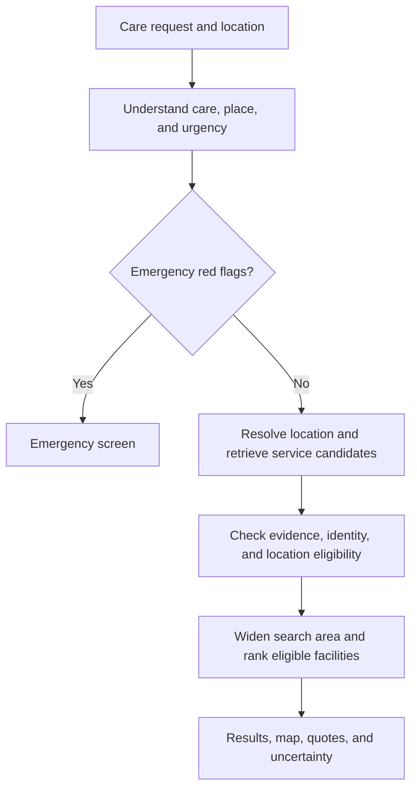

# Annu

**Find nearby hospitals with evidence for the care you need.**

Annu is a healthcare facility discovery application for India. Ask in everyday English, Hindi, or Hinglish, confirm the care and location Annu understood, and compare nearby facilities with the original evidence behind each recommendation.

The project combines a conversational React interface, a FastAPI recommendation service, Databricks-backed facility data, and reproducible retrieval and ranking experiments. The data workspace and some package names retain the earlier **Cardinal Virtues** name.

[Quick start](#quick-start) · [How it works](#how-recommendations-work) · [API](#api) · [Experiments](#experiments-and-evaluation) · [Documentation](#documentation)

## Features

- **Ask naturally.** Type “My father needs dialysis near Bhubaneswar.” Annu extracts care, place, and urgency, shows the words it used, and asks follow-up questions when needed.
- **Search by place or device location.** Use a city, district, six-digit Indian PIN code, or coordinates. Location aliases support older and alternate spellings.
- **Compare evidence and distance.** Browse ranked facilities and a Leaflet map. Open “Why this hospital?” for quotes, sources, score factors, and uncertainty.
- **Take the next step.** Open directions, call a facility when its record includes a number, or share results through WhatsApp.
- **Use English or Hindi.** Both interface languages include mobile layouts, light and dark themes, and reduced-motion support.
- **Speak your request.** Optional server-side Whisper transcription supports voice input, with browser speech recognition as a fallback where available.
- **Save preferences.** Optional setup stores a usual place, government-hospital preference, and emergency contact. Search remains available without sign-in.

Raahi, the map-pin mascot, guides the conversation. Rule-based red-flag screening can route messages to a dedicated emergency screen before any model call or recommendation search.

> Annu searches documented facility information. It does not diagnose conditions or verify current staffing, beds, treatment availability, or clinical quality. Confirm capabilities directly with the facility. Demo-mode records and evidence are illustrative.

## Quick start

### Frontend demo — no backend required

**Prerequisites:** Node.js 22.12+ and pnpm. The frontend declares its package-manager version in [`web/package.json`](web/package.json).

```bash
git clone https://github.com/Americium3/annu.git
cd annu/web
pnpm install
VITE_USE_DEMO=true pnpm dev
```

Open **http://127.0.0.1:5173**. Try a dialysis search near Bhubaneswar, then explore the map and facility details.

To build and preview the demo:

```bash
VITE_USE_DEMO=true pnpm build
pnpm preview
```

`VITE_*` settings are read at development-server startup or build time. The frontend connects to the real API by default; set `VITE_USE_DEMO=true` explicitly for a standalone demo.

### Full application with Databricks data

Use Python 3.12+ for a consistent environment across the Python components. The live backend requires an accessible Databricks SQL warehouse and prepared tables. Cloning this repository alone does not provide the full facility dataset.

From the repository root:

```bash
python3 -m venv .venv
source .venv/bin/activate
python -m pip install -r backend/requirements.txt

export DATABRICKS_HOST="https://<your-workspace>.cloud.databricks.com"
export DATABRICKS_WAREHOUSE_ID="<your-sql-warehouse-id>"
export DATABRICKS_TOKEN="<your-personal-access-token>"
export ANNU_SCHEMA="workspace.cardinal_virtues"

cd backend
uvicorn main:app --host 127.0.0.1 --port 8000
```

In a second terminal, from the repository root:

```bash
cd web
pnpm install
pnpm dev
```

Vite proxies `/api` to **http://127.0.0.1:8000**. Check **http://127.0.0.1:8000/api/health** for backend status or **http://127.0.0.1:8000/docs** for interactive API documentation.

The backend reads these tables under `ANNU_SCHEMA`:

| Table | Purpose |
| --- | --- |
| `serving_facilities` | Facility identity, coordinates, contacts, and quality flags |
| `serving_service_index` | Prepared facility–service evidence rows; loaded even when v2 is enabled |
| `ref_service_tags` | Curated service catalog and synonyms |
| `pincode_reference` | PIN-code coordinates and district/state references |
| `ref_address_alias` | Alternate city and state spellings |
| `model_evidence_items` | Original evidence used to build the default v2 service index |

Serving-table preparation is an upstream prerequisite. The backend documentation refers to notebook `06_build_serving_tables`, which is **not included in this repository**. See [`backend/data_store.py`](backend/data_store.py) for the exact columns expected by the loader.

The first successful load writes `backend/.cache/snapshot.pkl`. Later starts reuse it; set `ANNU_REFRESH=1` when launching the backend to reload Databricks data. Building the v2 index can take a few minutes. Keep credentials in the environment and never commit them.

## How recommendations work



1. **Understand the request.** Shared vocabulary and rules identify care, place, and urgency. Broad or incomplete requests trigger clarification. An optional Databricks LLM endpoint can fill gaps; extracted claims must be grounded in the user's words.
2. **Retrieve candidates.** The default v2 index reads procedures, capabilities, equipment, specialties, and descriptions. It distinguishes explicit service support from related, negated, planned, referred, or misattributed mentions.
3. **Apply eligibility checks.** Identity and location conflicts block recommendation. The default claim guard excludes explicit negative, planned/historical, or contradictory claims before radius selection and scoring.
4. **Choose the search area.** The backend widens through 25, 50, 100, and 200 km as needed, seeking at least three eligible facilities. Service-specific travel distances also influence the starting pool and ranking.
5. **Rank and explain.** Solid evidence comes before weak evidence. Within those groups, the default score combines proof strength and straight-line distance:

```text
closeness = 1 / (1 + (distance_km / travel_km)^2)
rank_score = proof_strength * closeness
```

Proof strength reflects evidence tier, source/plausibility adjustments, equipment-only support, and location confidence. Travel scales vary by care type; urgent requests emphasize proximity. The backend returns at most eight results with evidence and ranking factors.

**The live backend defaults to `rules` ranking.** Optional `cross_encoder` mode blends 30% text relevance with 70% proof strength before multiplying by closeness. An optional LLM judge reviews the top facilities' own record lines and can lower unsupported proof scores. Neither model output nor the displayed score is a calibrated availability probability.

The separate experimental engine and earlier `api/` ranker use different policies. Their defaults and scores should not be treated as live backend behavior. The frontend can further reorder returned results by distance or government-hospital preference.

## Configuration

| Variable | Default | Purpose |
| --- | --- | --- |
| `VITE_USE_DEMO` | unset / false | Use bundled demo data when `true` |
| `VITE_API_BASE` | empty | API base URL; empty uses the same origin |
| `ANNU_SCHEMA` | `workspace.cardinal_virtues` | Databricks catalog and schema |
| `ANNU_REFRESH` | unset | Reload source tables at startup when `1` |
| `ANNU_CACHE` | `backend/.cache/snapshot.pkl` | Snapshot location |
| `ANNU_SERVICE_INDEX` | `v2` | Build candidates from evidence; `v1` uses the prepared index |
| `ANNU_RANKING_METHOD` | `rules` | Select `rules` or optional `cross_encoder` |
| `ANNU_CLAIM_GUARD` | `explicit` | Claim checks; `strict` is experimental, `off` disables the extra guard |
| `ANNU_MIN_POOL_SIZE` | `3` | Eligible facilities sought before widening stops |
| `ANNU_LLM_ENDPOINT` | unset locally | Optional Databricks endpoint for request understanding and evidence judging |
| `ANNU_STT_MODEL` | `openai/whisper-small` | Voice model; `off` disables server transcription |

Whisper and cross-encoder mode require model downloads or preloaded checkpoints. The deployment configuration sets an LLM endpoint explicitly; local execution uses rules when no endpoint is configured. See [`backend/README.md`](backend/README.md) for model, batching, CORS, and ranking options.

## API

| Method | Endpoint | Purpose |
| --- | --- | --- |
| `GET` | `/api/health` | Data source and ranking, language-model, and voice status |
| `GET` | `/api/services` | Service catalog and suggestions |
| `GET` | `/api/locations?q=...` | Location suggestions |
| `POST` | `/api/ask` | Understand free text and return a next action or recommendations |
| `POST` | `/api/recommendations` | Search by service, location/coordinates, and optional urgency or judge |
| `POST` | `/api/transcribe?lang=en` | Transcribe raw 16 kHz mono 16-bit PCM audio; `hi` is also supported |

```bash
curl -X POST http://127.0.0.1:8000/api/ask \
  -H 'Content-Type: application/json' \
  -d '{"text":"My father needs dialysis near Bhubaneswar"}'

curl -X POST http://127.0.0.1:8000/api/recommendations \
  -H 'Content-Type: application/json' \
  -d '{"serviceText":"dialysis","locationText":"Bhubaneswar"}'
```

`/api/ask` returns `next` as `emergency`, `ask_care`, `ask_place`, or `results`. Structured searches return `422` with a field, message, and suggestions when care or location cannot be resolved. See [`web/src/types.ts`](web/src/types.ts) for response contracts.

## Repository layout

| Path | Contents |
| --- | --- |
| [`web/`](web/) | React 19, TypeScript, Vite, React Router, and Leaflet frontend |
| [`backend/`](backend/) | Live FastAPI server: NLU, evidence checks, ranking, optional judge, and transcription |
| [`pipeline/`](pipeline/) | Databricks SQL client, tag extraction, vocabulary, taxonomy crosswalks, and v2 indexing |
| [`data/tags/`](data/tags/) | Committed catalogs, aliases, taxonomy mappings, and tag reports |
| [`experiments/`](experiments/) | Retrieval/ranking comparisons, benchmark tools, recorded results, and regression fixtures |
| [`notebooks/`](notebooks/) | Databricks experiment and accuracy-benchmark entry points |
| [`api/`](api/) | Earlier standalone phase-1 ranker; not the frontend's API server |
| [`docs/ranking_model.md`](docs/ranking_model.md) | Earlier phase-1 ranking design |
| [`web/databricks-app/`](web/databricks-app/) | Node server, app configuration, and Databricks deployment script |
| [`APP_FRAMEWORK_REQUIREMENTS.en.md`](APP_FRAMEWORK_REQUIREMENTS.en.md) | Product/system requirements; intended scope may exceed implemented features |

## Experiments and evaluation

The repository compares rules, TF-IDF, BM25, bi-encoders, cross-encoders, and additional model variants. Saved reports distinguish development-set results from synthetic claim-handling diagnostics.

The recorded [`golden_eval` development report](experiments/RESULTS.md) reports:

| Recorded configuration | P@3 | nDCG@3 |
| --- | ---: | ---: |
| Earlier cross-encoder baseline (`E0_live_ce`) | 0.321 | 0.314 |
| Earlier rules baseline (`E0_live_rules`) | 0.369 | 0.351 |
| Improved rules configuration (`E9_shipped_defaults`) | 0.881 | 0.779 |

These are **historical development results**, not a fresh evaluation of every subsequent change. The report uses 29 queries, including one no-result case, with rule-generated silver labels rather than independent clinical judgments; its test split was not evaluated. Recorded gains mainly came from location resolution and candidate retrieval. Text-model comparisons did not establish a reliable gain over the improved rules configuration.

The separate [claim challenge](experiments/results/claim_challenge/README.md) uses synthetic fixtures and a small audit of repository excerpts. Its scores do not establish accuracy on the full facility dataset or real-world availability. Independent labels and access to the source tables are needed for that assessment.

For data contracts, comparison commands, and benchmark outputs, see [`experiments/README.md`](experiments/README.md). Databricks entry points include [`100_two_stage_experiments.py`](notebooks/100_two_stage_experiments.py), [`110_accuracy_benchmark.py`](notebooks/110_accuracy_benchmark.py), and [`111_serving_accuracy_benchmark.py`](notebooks/111_serving_accuracy_benchmark.py).

## Development checks

Frontend checks, from `web/` after installing dependencies:

```bash
pnpm test
pnpm typecheck
pnpm build
```

Python checks, from the repository root with the relevant dependencies installed:

```bash
python -m pip install -r backend/requirements.txt -r experiments/requirements.txt
python backend/test_ranking.py
python -m unittest discover -s backend/tests -v
python -m unittest discover -s pipeline/tests -v
python -m unittest discover -s experiments/tests -v
```

These suites use local fixtures and mocked model behavior where needed; they do not require live Databricks access or downloaded model weights. To test the separate phase-1 ranker, install pytest and run `python -m pytest` from `api/`.

## Deployment

[`web/databricks-app/`](web/databricks-app/) packages the frontend and Python backend into a Databricks App. Its Node server serves the built site, forwards API requests to FastAPI, and handles SPA routes. The backend can authenticate with the app's service-principal credentials.

See the [deployment guide](web/README.md#发布到-databricks--deploy-to-databricks-apps) before running the script: it uploads application files, creates or updates app resources, grants data permissions, and gives account users access. Review the target app name, warehouse, schema, and model endpoint for your workspace. The bundled deployment requires Databricks sign-in; it is not a public anonymous demo.

## Current boundaries

- The repository includes catalogs and synthetic fixtures, but not a complete export of the live facility tables or a ready-to-use serving snapshot.
- Evidence extraction, urgency screening, location resolution, and claim checks rely on heuristics. Quotes can be stale, incomplete, or misattributed.
- Ranking uses straight-line distance rather than verified road routes or travel times. PIN-area coordinates are approximate.
- Phone OTP sign-in is a demo: it sends no SMS and accepts `123456`. Replace [`web/src/lib/auth.ts`](web/src/lib/auth.ts) before enabling real authentication.
- Voice recognition depends on model/browser availability. Hindi wording still needs native-speaker review.

## Documentation

- [Frontend, user flows, and hosting](web/README.md)
- [Backend behavior and configuration](backend/README.md)
- [Data pipeline and medical vocabulary](pipeline/README.md)
- [Experiment setup and benchmark contracts](experiments/README.md)
- [Recorded development results](experiments/RESULTS.md)
- [Synthetic claim-handling diagnostics](experiments/results/claim_challenge/README.md)
- [Earlier phase-1 ranking design](docs/ranking_model.md)
