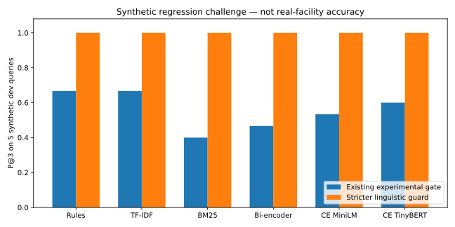

# Recorded recommendation diagnostics

**These are SYNTHETIC regression results, not accuracy on the competition hospitals.**

The repository did not contain a usable export of `model_facilities`, `model_evidence_items`
or the serving snapshot, and this environment had no Databricks credentials. Read-only
workspace API checks returned 401 for both referenced workspaces (`access.json`). No
real-facility accuracy improvement or best production model has been established.
A separate audit of 62 real text excerpts already present in the repository is recorded below;
these excerpts do not constitute a complete facility dataset.

## What was actually executed

- 128 configurations of the experimental engine: rules, TF-IDF, BM25, a real bi-encoder,
  and two real cross-encoder checkpoints; text weights .25/.50/.75, distance scales 15/60km,
  max/top-two mean aggregation, guard off/on. All 128 succeeded.
- 36 configurations calling the **actual web backend**, preserving its formal gate,
  adaptive radius, solid/weak proof grouping and multiplicative closeness formula.
  These compare rules/cross-encoder, guard off/explicit/strict, weights .25, 4/7, .75,
  and travel multipliers .5/1/2. All 36 succeeded.
- Real downloaded model weights were used for neural runs; no mocked neural scores.
  Unit tests separately use deterministic fake logits to verify API contracts.
- The generated fixture contains 120 synthetic facilities/evidence rows, 10 queries,
  120 qrels, 5 services, 12 linguistic cases each, split into 5 dev and 5 test queries.
  For the serving fixture, all claims are deliberately tagged formal/usable to simulate
  upstream extraction errors. This is an adversarial stress test, not typical data prevalence.

Model checkpoints and resolved revisions are in `manifest.json`. Package versions, data/
query/qrels/source hashes, every attempted configuration, per-query metrics and frozen
baseline/winner test comparisons are recorded. Serving logs are in `serving/`.

## Fixed-setting dev comparison: experimental engine

The table holds aggregation=max and distance decay=15km fixed; text weight=.50
(rules=0). This table is a controlled dev diagnostic, not the frozen test comparison.

| Method | P@3: existing gate | P@3: stricter guard | nDCG@3: existing gate |
|---|---:|---:|---:|
| Rules | .667 | 1.000 | .765 |
| TF-IDF | .667 | 1.000 | .765 |
| BM25 | .400 | 1.000 | .528 |
| Bi-encoder: multi-qa-MiniLM-L6-cos-v1 | .467 | 1.000 | .494 |
| Cross-encoder: ms-marco-MiniLM-L6-v2 | .533 | 1.000 | .553 |
| Cross-encoder: ms-marco-TinyBERT-L2-v2 | .600 | 1.000 | .625 |



Raw fixed-setting values are in `fixed_comparison.csv`. `v004` (guarded rules) ties
with several models at 1.0 and is selected by stable ID, not evidence that rules are
generally best. Frozen synthetic test: baseline P@3=.667/nDCG=.765; selected P@3=1/nDCG=1.

## Fixed-setting dev comparison: actual web backend

Original travel scale, cross-encoder text weight=4/7, rules text weight=0:

| Method | Claim policy | P@3 | nDCG@3 |
|---|---|---:|---:|
| Existing cross-encoder policy | off | .267 | .247 |
| Rules | off | .667 | .765 |
| Cross-encoder | explicit | .467 | .447 |
| Rules | explicit | .667 | .765 |
| Cross-encoder | strict | 1.000 | 1.000 |
| Rules | strict | 1.000 | 1.000 |

The experimental and serving formulas differ; **do not compare their absolute scores
as if they were the same baseline**. Actual-serving dev selects `s024` (strict rules,
travel multiplier=.5) by tie-break. Frozen synthetic test goes from baseline P@3=.267/
nDCG=.247 to 1.0/1.0. All strict variants tie on this fixture, so it provides no credible
basis for choosing a travel scale or deploying rules over the current cross-encoder.
See `serving/fixed_comparison.csv`, `serving/test_per_query.csv` and `serving/errors.csv`.

## What this diagnoses

A real MiniLM cross-encoder gives the query `Dialysis` a score of .000329 for
“Our hospital provides haemodialysis treatment.” and .933307 for “Patients are referred
elsewhere for dialysis.” (`claim_diagnostic.json`). These are relevance scores, not
availability probabilities. Topic matching can promote a referral over a provider;
evidence checks must precede ranking. The example does not prove all synonym queries fail.

The serving change defaults to **explicit** negative/planned/conflict exclusion. `strict`
also filters referrals/awareness/training, but stays experimental because mixed positive
and educational text can be falsely rejected. Default ranking method and 4:3 weights
remain unchanged. Removed evidence cannot retain its old proof counts/strong tier.

## Limits: do not turn these into real-data improvement claims

Dev/test reuse the same linguistic templates, and guards target those same constructs.
The holdout is therefore only a regression check, not independent generalization. The
bootstrap intervals in the manifests are arithmetic diagnostics of these fixtures,
**not statistical evidence of clinical or real-data superiority**. There is one evidence
item per facility, so max vs top-two aggregation is not meaningfully exercised here.
Only 5 services are included; emergency C-section, clinical readiness, merged entities,
location conflicts, sparse geography and present-day availability are not validated.
Weights and latency cannot be chosen from this small, highly constructed dataset.

## Additional check: 62 repository-derived real text excerpts

`data/tags/tfidf_tag_report.json` includes selected excerpts whose metadata names
`model_evidence_items` as the source. We audited all **62 displayed examples** for the
six target service tags with the actual MiniLM cross-encoder and the linguistic guard.
No hospital ID, coordinates, full record or independent availability labels are included.

This caught an actual wording error in the strict guard: “Burns unit is a high-referral
center for complex burns...” describes a center receiving referrals, not patients being
referred elsewhere. The guard now recognizes this distinction while still filtering
outgoing-referral-only wording. On the 30 examples the **previous model** called strong,
strict retention changes from 29/30 to 30/30. This is an excerpt-retention diagnostic,
**not a measured accuracy gain**: the original buckets/probabilities are model outputs.

Two other excerpts remain flagged indirect under strict mode: outgoing C-section referral,
and a description of a training/lactation center near a NICU. Their real availability
cannot be adjudicated without their full facility records. Default explicit mode retains
all 62. The samples are selected and small, so these counts cannot establish full-dataset
recall or safety. See `repository_excerpts/excerpt_audit.csv`, `retention_counts.csv` and
`manifest.json` for exact text, scores, source hashes and before/after flags.

Reproduce this **separate, unlabelled excerpt audit** with:

```bash
python -m experiments.audit_repository_examples --neural --out /path/new_excerpt_audit
```

## Reproduce and continue on real data

Install `experiments/requirements-neural.txt`, then from the repository root run:

```bash
bash experiments/results/claim_challenge/REPRODUCE.sh /path/to/new_run
python experiments/results/claim_challenge/summarize.py
```

The first command runs the models into new outputs. The second only rebuilds tables/
figure from the checked-in results. To evaluate real facilities, run
`notebooks/110_accuracy_benchmark.py` and **111_serving_accuracy_benchmark.py** in an
authenticated Databricks Git folder. Provide independently reviewed qrels and grouped
queries; keep location/entity clusters and equivalent queries in a single split.
Select on fully judged dev only, freeze the policy, report untouched test P@3/nDCG@3,
false abstention and error types. Missing labels prevent winner selection; nothing
automatically replaces the production policy. Outputs contain evidence and belong in a
private Volume. The raw real dataset should not be committed to this public repository.

Validation: 108 tests passed (25 backend, 35 experiment, 44 API/pipeline, 4 ranking),
plus Python compilation and `git diff --check`. Real Databricks notebook execution
has not occurred in this environment.
